#  Pet Cheri - Case Study

> Refonte complète d'une conciergerie animalière premium : site vitrine, application web à trois portails (clients, prestataires, équipe) et future application mobile, menée en quatre mois comme CPTO

<div align="center">

[](https://nextjs.org/)
[](https://react.dev/)
[](https://www.typescriptlang.org/)
[](https://expo.dev/)
[](https://openai.com/)
[](https://playwright.dev/)

**[🌐 petcheri.com](https://petcheri.com)**

</div>

<div align="center">
  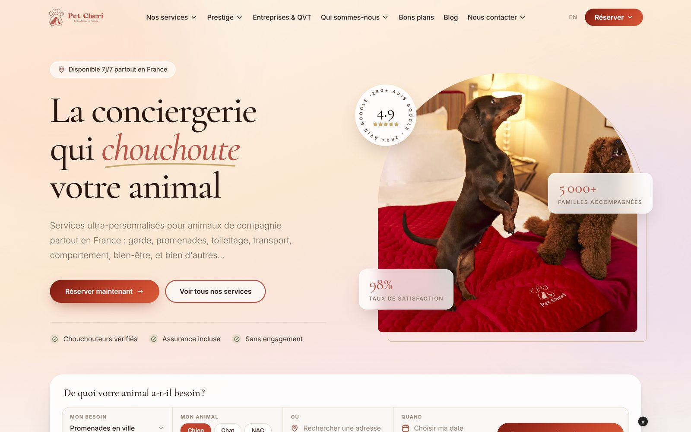
  <br/>
  <em>Le nouveau site vitrine, reconstruit en Next.js après Webflow</em>
</div>

---

## 📑 Menu

- [Contexte](#-contexte)
- [Avant / Après](#️-avant--après)
- [Trois surfaces, un seul produit](#-trois-surfaces-un-seul-produit)
- [Fonctionnalités clés](#-fonctionnalités-clés)
- [Décisions clés](#-décisions-clés)
- [Qualité & gouvernance](#-qualité--gouvernance)
- [Ampleur du projet](#-ampleur-du-projet)
- [Hypothèses à valider](#-hypothèses-à-valider)
- [Stack](#️-stack)
- [Roadmap](#️-roadmap)
- [Learnings](#-learnings)

### 📚 Documentation détaillée

1. [Vision et contexte](./docs/01-vision-et-contexte.md)
2. [Le design system « lux »](./docs/02-design-system-lux.md)
3. [Parcours client et prestataire](./docs/03-parcours-client-et-prestataire.md)
4. [L'assistant IA PACO](./docs/04-assistant-paco.md)
5. [Facturation et comptabilité](./docs/05-facturation-et-comptabilite.md)
6. [Méthode Product Owner](./docs/06-methode-po.md)

---

## 👋 Contexte

Pet Cheri est une conciergerie animalière premium basée à Paris : garde, promenades, visites à domicile, toilettage, transport, éducation. L'entreprise a environ cinq ans. Sa plateforme met en relation des propriétaires d'animaux et des prestataires (les « chouchouteurs ») sélectionnés par l'équipe, qui suit chaque demande, choisit le bon prestataire, facture et encaisse.

La plateforme tourne en production depuis décembre 2025. Une première version fonctionnelle avait été livrée par un développeur freelance : elle faisait le travail, mais elle avait été pensée comme un outil, pas comme le prolongement d'une marque premium.

J'ai rejoint Pet Cheri comme **CPTO** fin mai 2026. Mon périmètre : le site vitrine, l'application web, l'application mobile, la méthode produit et l'exploitation. Je cadre les besoins avec l'équipe (concierges, comptabilité, marketing), je conçois les écrans, puis je développe et teste avec des agents IA.

**Pain points de départ :**
- ❌ **Une interface plate**, sans lien visuel avec la marque : un client passait d'un site chaleureux à une application générique
- ❌ **Un site vitrine bloqué sur Webflow**, difficile à faire évoluer, sans SEO local ni passerelle vers l'application
- ❌ **Aucun test automatisé** : chaque correction risquait d'en casser une autre
- ❌ **Une facturation corrigée à la main** : doublons de références, régularisations faites hors de l'outil
- ❌ **Une sécurité jamais auditée**
- ❌ **Une équipe sans documentation** : le fonctionnement de l'outil vivait dans la tête de quelques personnes

---

## 🖼️ Avant / Après

### Le site vitrine

<table>
<tr>
<th width="50%">Avant (Webflow, juin 2026)</th>
<th width="50%">Après (Next.js)</th>
</tr>
<tr>
<td>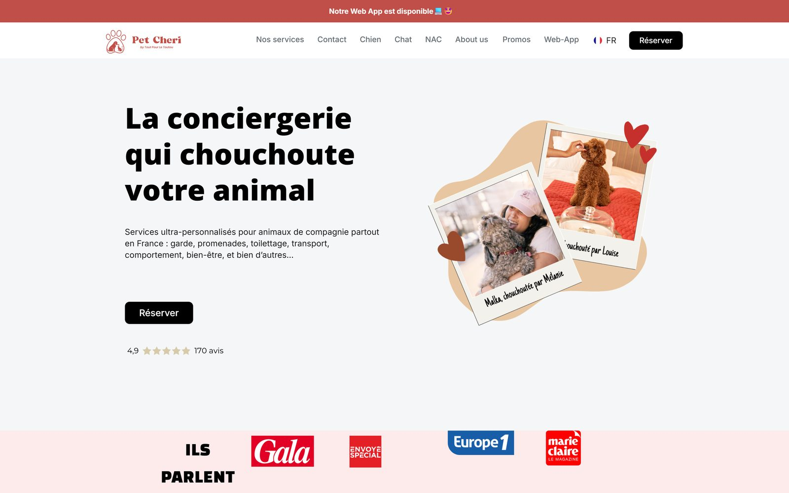</td>
<td></td>
</tr>
<tr>
<td>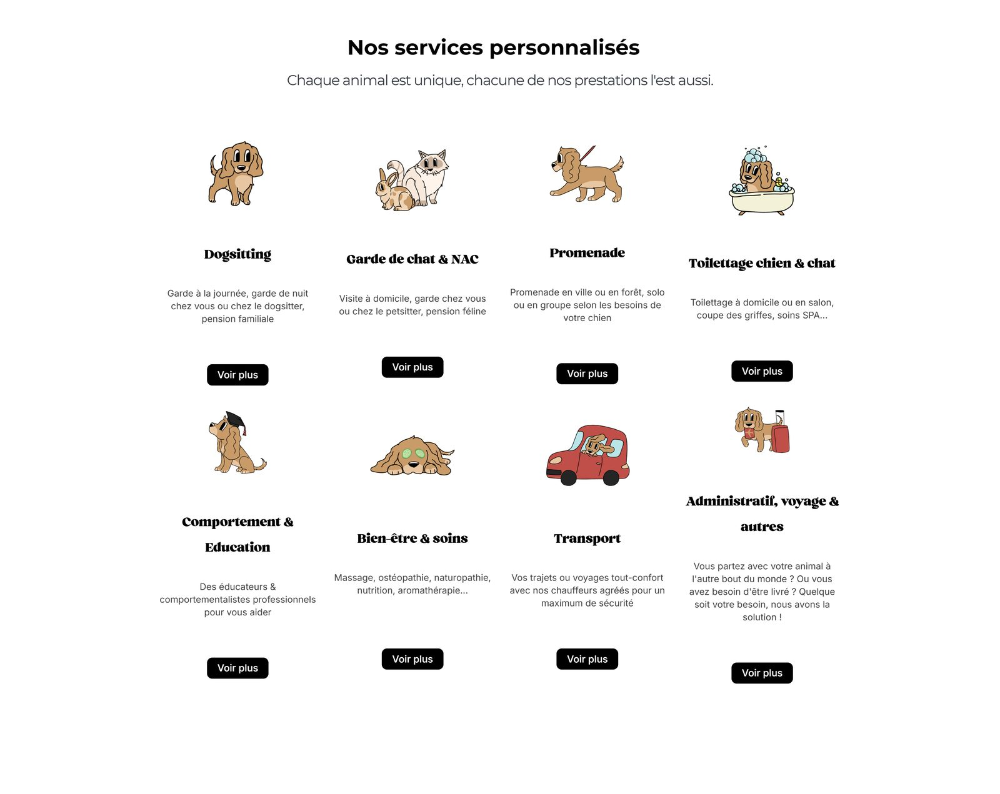</td>
<td>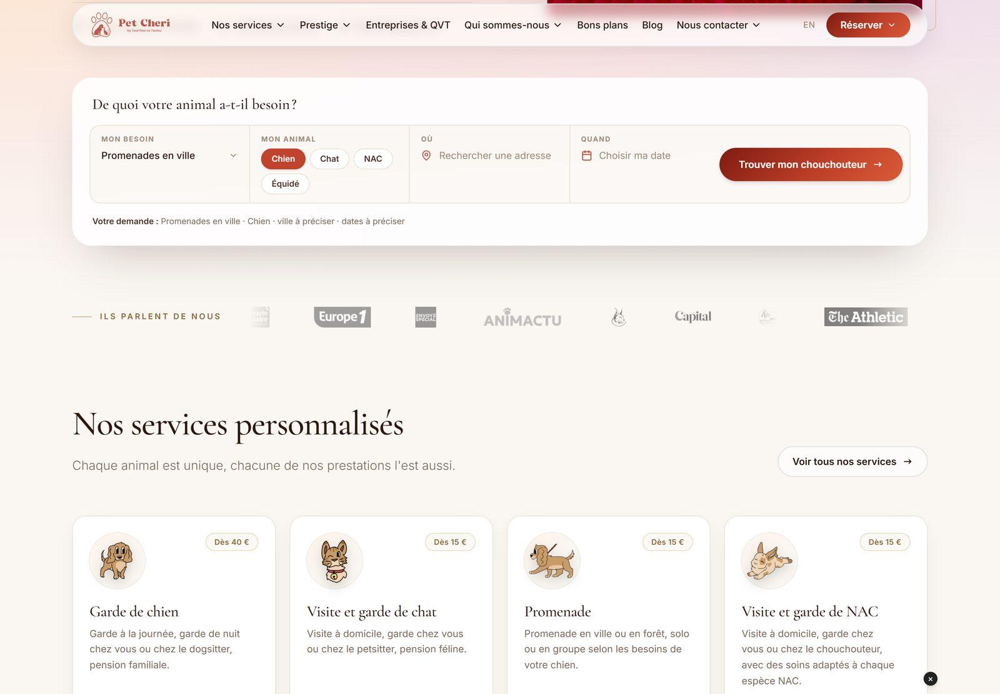</td>
</tr>
</table>

Le nouveau site garde l'identité (illustrations, ton « chouchoutage ») mais l'habille en premium : serif Cormorant Garamond, ivoire et corail, mot-accent en italique. Le héro ne se contente plus d'un bouton « Réserver » : un sélecteur de devis (besoin, animal, adresse, date) ouvre directement le formulaire de demande de l'application, déjà rempli.

### L'espace client

<table>
<tr>
<th width="50%">Avant</th>
<th width="50%">Après</th>
</tr>
<tr>
<td>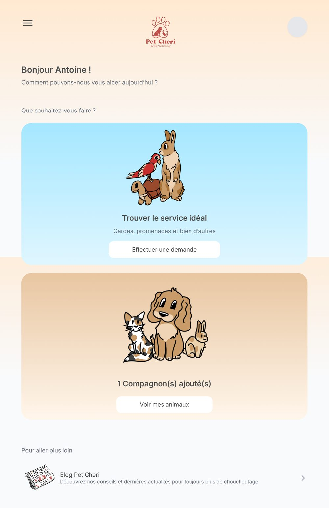</td>
<td></td>
</tr>
<tr>
<td>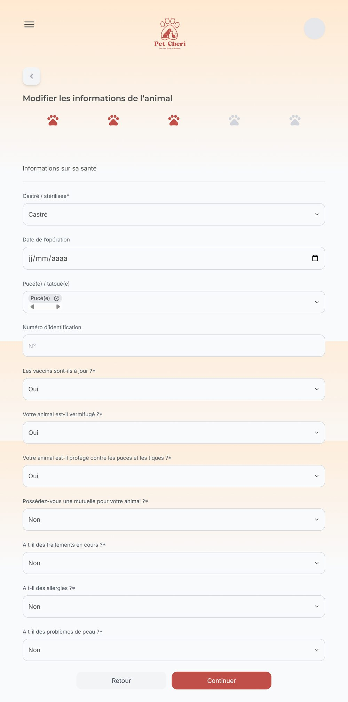</td>
<td></td>
</tr>
</table>

L'ancien accueil posait deux grandes cartes illustrées et rien d'autre. Le nouveau répond aux questions qu'un client se pose en ouvrant l'application : où en est ma demande, combien j'ai à régler, quels bons plans me concernent (choisis selon l'espèce et l'âge de son animal, ou l'absence de mutuelle). La fiche animal passe de listes déroulantes « Oui / Non » à des choix d'un seul toucher et à un stepper qui montre l'étape en cours.

### L'espace équipe

<table>
<tr>
<th width="50%">Avant</th>
<th width="50%">Après</th>
</tr>
<tr>
<td>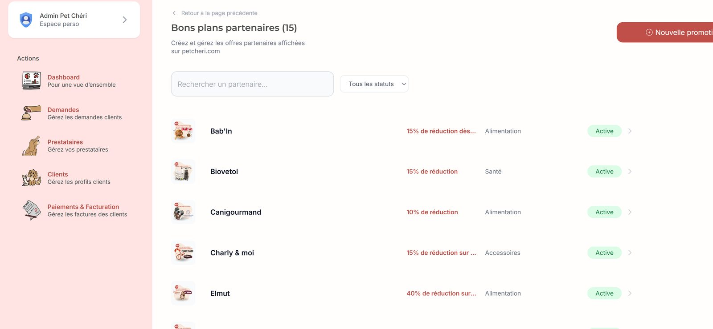</td>
<td>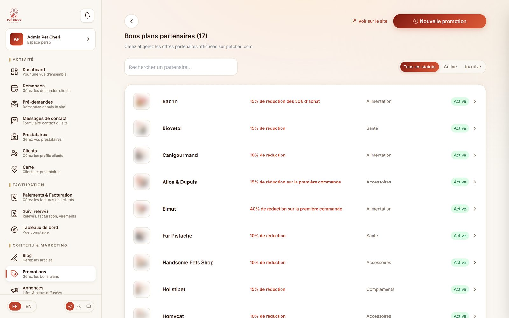</td>
</tr>
</table>

Le menu de l'équipe passe de cinq entrées illustrées à une navigation rangée par métier (activité, facturation, contenu et marketing, administration), avec une icône animée par usage.

<div align="center">
  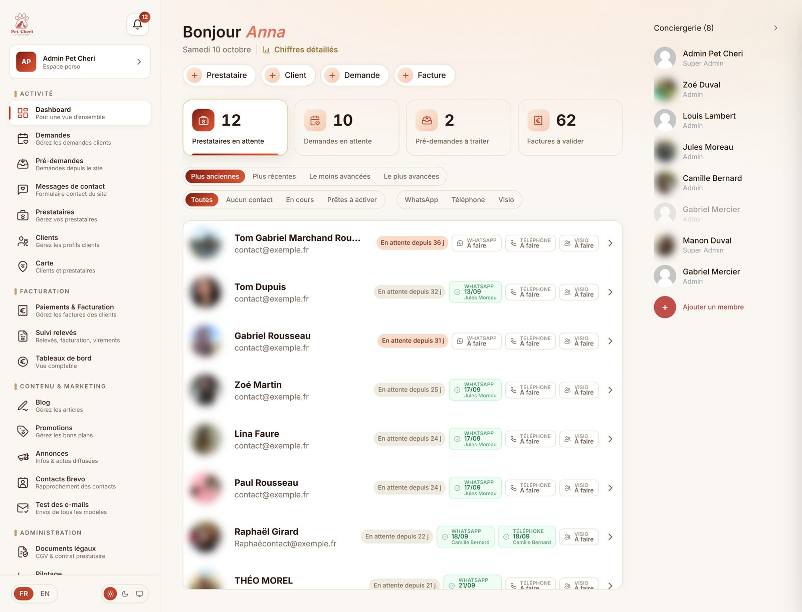
  <br/>
  <em>Le tableau de bord de l'équipe : files de travail, raccourcis de création, suivi des candidatures (noms fictifs)</em>
</div>

---

## 🧭 Trois surfaces, un seul produit

| Surface | Pour qui | Ce qui a changé |
|---|---|---|
| **Site vitrine** petcheri.com | Visiteurs, SEO | Reconstruit de Webflow vers Next.js : 44 pages FR / EN, pages locales par ville et arrondissement avec carte, sélecteur de devis, connexion Google en un clic, blog et bons plans lus depuis la base de l'application |
| **Application web** | Clients, prestataires, équipe | Trois portails redessinés dans une charte commune, mode sombre, français et anglais, assistant IA, refonte de la facturation |
| **Application mobile** | Clients, prestataires | Expo / React Native, réutilise l'API de l'application web, agent vocal Paco. En cours de finalisation, pas encore publiée |

Le parcours relie les trois surfaces :

```
[Visiteur sur petcheri.com]
    ↓  sélecteur de devis (besoin, animal, adresse, date)
[Formulaire /demande prérempli, sans compte]
    ↓  pré-demande envoyée à l'équipe, ou compte créé
[Espace client : animaux, demandes, bons plans]
    ↓  l'équipe choisit le prestataire (carte, critères de l'animal)
[Prestataire : missions, planning, relevé du mois]
    ↓
[Note de débit → paiement Stripe → facture de commission]
```

<div align="center">
  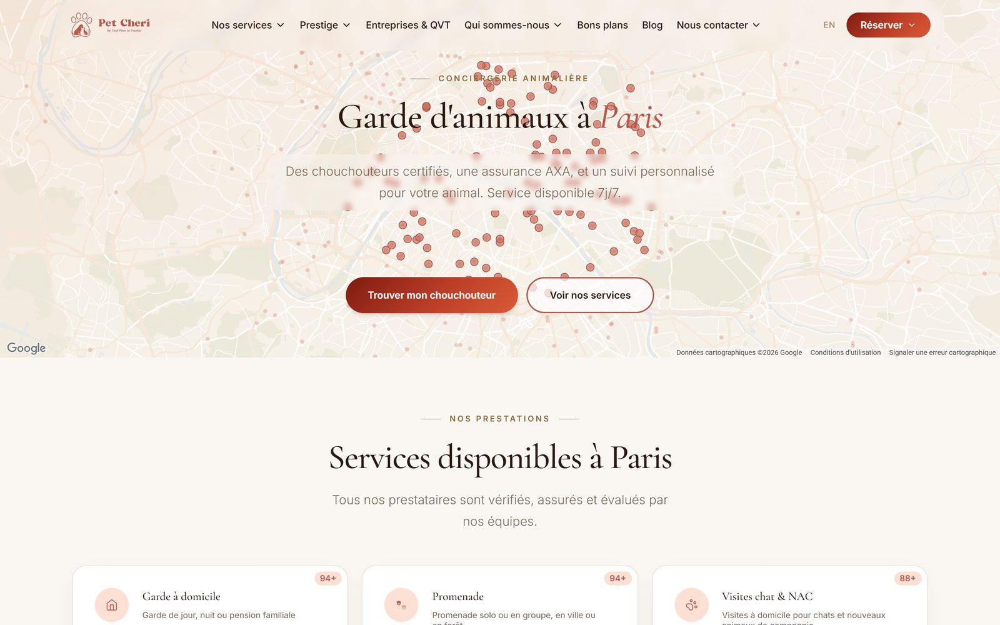
  <br/>
  <em>Une page locale de la vitrine : la carte montre les prestataires de la ville</em>
</div>

---

## 🚀 Fonctionnalités clés

### 1. Une charte « lux » commune aux trois portails

Née dans l'espace client, étendue ensuite aux prestataires puis à l'équipe. Tokens de couleur (ivoire, chocolat, or, corail), un seul bouton principal par écran, 38 icônes animées dessinées à la main avec une règle simple : une icône par usage. Toute la charte existe aussi en **mode sombre**, sans une ligne de code en plus par écran : seuls les tokens changent de valeur. Une page `/design` sert de vitrine interne au marketing et aux prestataires extérieurs, rendue par les vrais composants.

<div align="center">
  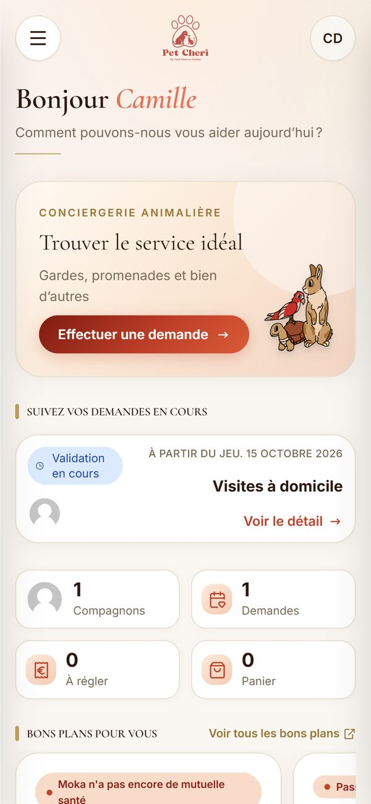
  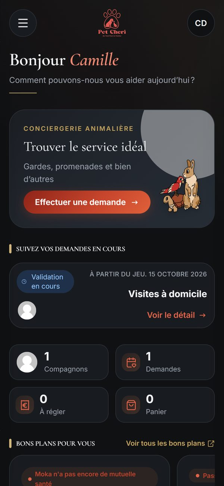
  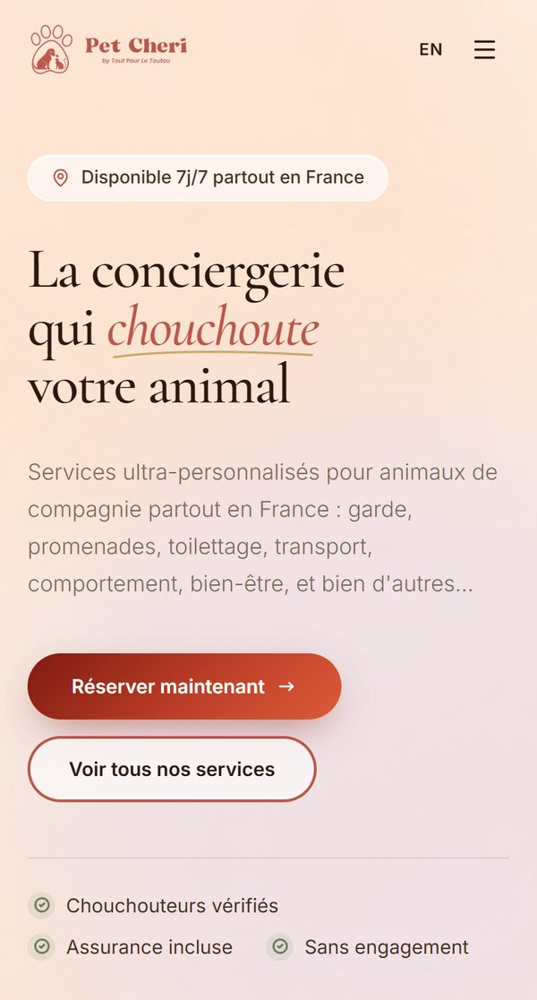
  <br/>
  <em>Espace client en clair et en sombre, vitrine sur téléphone</em>
</div>

### 2. Un tunnel de demande sans compte

Un visiteur peut décrire son besoin sans créer de compte. Sa pré-demande arrive chez l'équipe, qui la transforme en vraie demande en un clic. Le tunnel est instrumenté (GTM / GA4) et chaque demande garde la page et le bouton de la vitrine qui l'ont amenée.

### 3. PACO, un assistant IA qui propose et n'écrit jamais

Côté client, PACO prépare une demande à partir des habitudes de la personne (« une promenade demain avec ma presta habituelle ») et pose les questions à choix dans une carte. Côté équipe, il répond sur les données et le fonctionnement de l'outil, transforme une conversation WhatsApp collée en demande et rédige les tickets du sprint. Côté prestataire (en recette), il remplit le relevé du mois à partir d'une phrase (« tout sauf la promenade du lundi »). Voir [l'assistant PACO](./docs/04-assistant-paco.md).

<div align="center">
  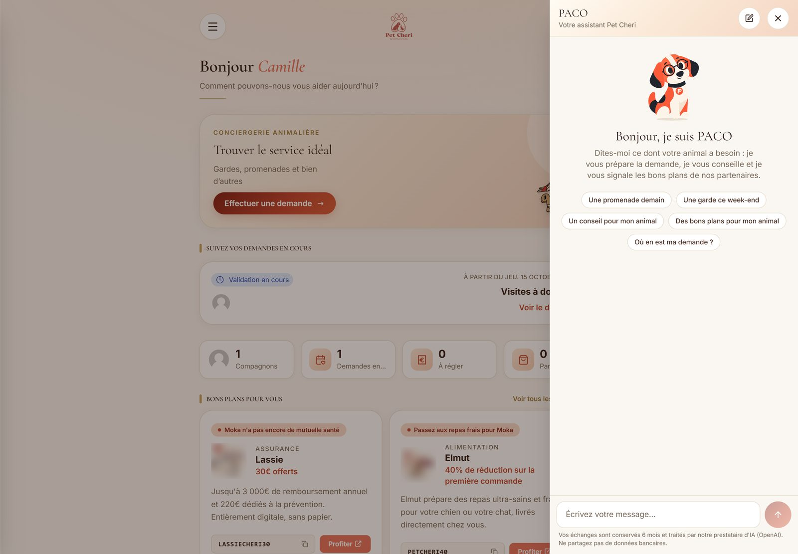
  <br/>
  <em>PACO dans l'espace client : réponses à toucher, la demande se prépare en un ou deux échanges</em>
</div>

### 4. Une facturation que la comptabilité peut signer

Une note par client et par mois, regroupant tous ses prestataires. Une note émise ne se modifie plus : toute baisse passe par un avoir, toute hausse par une facture complémentaire, qui citent la note d'origine. Numéro provisoire tant que la note n'est pas validée, numéro définitif à l'émission. Facture de commission figée et numérotée, journal des ventes en partie double pour l'expert-comptable, tableaux de bord par société. Voir [facturation et comptabilité](./docs/05-facturation-et-comptabilite.md).

### 5. Le relevé mensuel du prestataire, sans connexion

Chaque mois, le prestataire reçoit un lien personnel : il coche ce qu'il a fait, ajoute ce qui manque, transmet. L'équipe suit les relevés reçus sur un tableau dédié et facture à partir de là.

### 6. Une carte clients / prestataires

Plusieurs milliers de points affichés sur une carte, la demande des douze derniers mois en chaleur, les zones en tension (beaucoup de demandes, peu de prestataires), les candidats et les prestataires inactifs. Ouverte depuis une demande, elle se centre sur le client et filtre le service demandé.

<div align="center">
  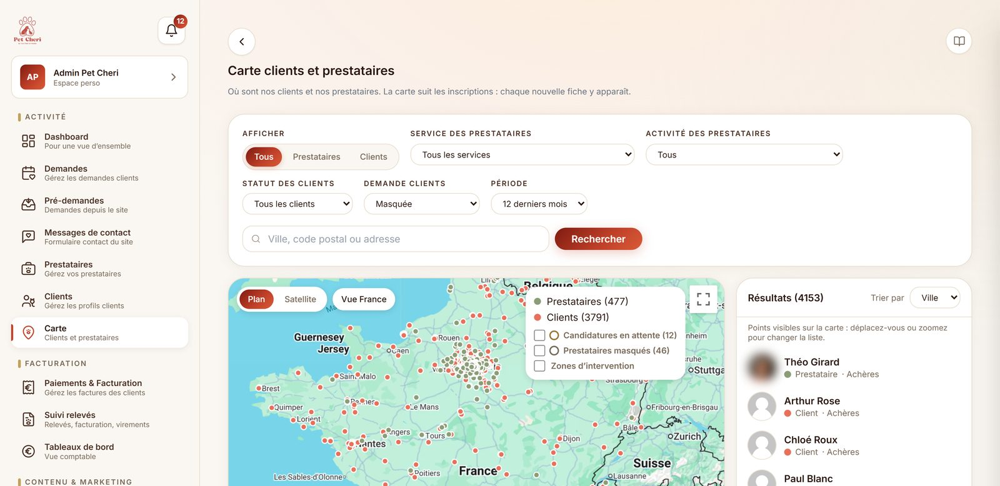
  <br/>
  <em>La carte de l'équipe : où sont les clients, où manquent les prestataires</em>
</div>

### 7. Communication : annonces, e-mails de cycle de vie, transactionnels

Bandeaux d'annonce dans l'application (ciblés par code postal, statut du prestataire, avec accusé de lecture), dix e-mails de cycle de vie (relance après inscription, inactivité, parrainage, anniversaire, avis) et seize e-mails transactionnels FR / EN refaits dans la charte, générés par script plutôt que retouchés à la main. Un banc d'essai liste chaque envoi et permet d'en recevoir un exemplaire.

### 8. Sécurité des comptes

Double authentification (TOTP) pour l'équipe et, en option, pour les prestataires, verrouillage après cinq échecs, signature des jetons réellement vérifiée, listes blanches de champs modifiables, liens à usage unique pour le mot de passe oublié, effacement de compte confirmé par e-mail.

### 9. Des tutoriels vidéo générés depuis l'application

Dix-huit tutoriels de trois à quatre minutes, pour l'équipe et les prestataires : captures de l'application refaites par script avec les vrais noms masqués, voix de synthèse, caméra qui zoome sur l'élément dont parle la voix. Quand un écran change, on relance les captures et le rendu, sans tournage.

<div align="center">
  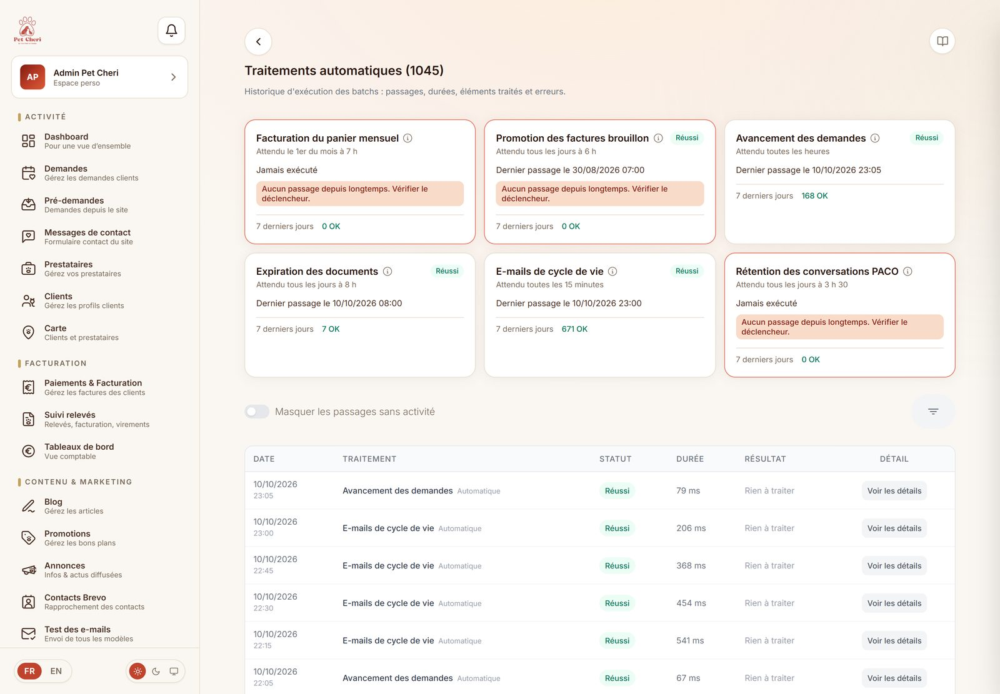
  <br/>
  <em>La supervision des traitements automatiques : chaque batch, son dernier passage et ce qu'il a modifié</em>
</div>

---

## 🎯 Décisions clés

### Une seule note de débit par client et par mois

**Problème identifié :** un client suivi par trois prestataires dans le mois recevait trois notes, l'équipe en corrigeait une partie à la main.

**Décision :** un panier mensuel par client, facturé en une note qui regroupe toutes ses demandes et tous ses prestataires. Seule la société de facturation peut scinder la note. J'ai écarté un nouveau statut de proposition, qui aurait obligé à modifier chaque écran du parcours.

**Impact :** une note par mois pour le client, et une facturation déclenchée par l'équipe quand tous les prestataires du mois ont transmis leur relevé. Un batch rattrape les mois oubliés.

### Une note émise ne se modifie plus

**Problème identifié :** des notes déjà envoyées au client étaient retouchées après coup, ce que la comptabilité ne peut pas accepter.

**Décision :** une note émise est figée. Une baisse devient un avoir, une hausse une facture complémentaire, et les deux citent la note d'origine. Pour les cas courants (un créneau ajouté, des dates de garde changées), l'outil calcule lui-même l'écart et prépare le bon document.

**Impact :** une chaîne de documents que l'expert-comptable peut relire, et des statistiques qui déduisent les avoirs partout.

### PACO propose, l'humain confirme

**Problème identifié :** un assistant IA branché sur des données de facturation et de clients ne doit jamais agir seul.

**Décision :** le modèle n'écrit jamais. Une écriture devient une carte « à confirmer » ; seul le clic de la personne qui l'a demandée l'exécute, avec ses propres droits, et l'historique la marque « via PACO ». Aucune suppression n'est représentable.

**Impact :** l'équipe peut confier à PACO les petites écritures (statut, date de rencontre, note interne) sans risque de dérive. Les clôtures, refus et relances restent à l'écran.

### Pas de conseil santé

**Problème identifié :** les clients posent à PACO des questions sur la santé de leur animal.

**Décision :** PACO donne des conseils du quotidien (alimentation, jeux, préparation d'une garde). Santé et éducation sont renvoyées à l'équipe par WhatsApp, le vétérinaire de garde en cas d'urgence.

**Impact :** l'assistant reste utile sans engager la responsabilité de l'entreprise sur un diagnostic.

### Écarter un prestataire seulement quand on lui a posé la question

**Problème identifié :** la recherche de prestataires écartait ceux qui n'avaient pas renseigné un critère (castration acceptée, traitements), y compris quand leur formulaire ne leur demandait jamais ce critère.

**Décision :** la règle « non renseigné, donc écarté » ne s'applique qu'aux services dont le formulaire pose vraiment la question.

**Impact :** moins de prestataires écartés à tort, et une règle que l'équipe peut expliquer.

### Le thème du téléphone par défaut, les documents toujours en clair

**Problème identifié :** un client dont le téléphone est en mode sombre arrivait sur une application éblouissante ; à l'inverse, un PDF généré par un admin en mode sombre partait chez le client fond noir.

**Décision :** le thème suit le réglage du système par défaut, sur les trois portails. Tout document destiné au papier ou au PDF est forcé en clair.

**Impact :** un confort de lecture le soir, et des notes de débit identiques quel que soit l'écran de celui qui les génère.

### Effacer un compte, c'est l'anonymiser

**Problème identifié :** supprimer un client aurait emporté ses notes, que l'entreprise doit conserver.

**Décision :** l'effacement demandé au titre du RGPD anonymise la fiche et garde les documents comptables.

**Impact :** le droit à l'effacement est respecté sans trou dans la comptabilité.

---

## ✅ Qualité & gouvernance

| Chantier | Ce qui existe aujourd'hui |
|---|---|
| **Tests** | 465 tests unitaires Playwright sur les règles sensibles (droits sur les notes, champs modifiables, calculs financiers, avoirs, garde-fous de l'assistant) et des parcours de bout en bout |
| **Audits** | Programme de 12 audits : sécurité, intégrité des données, workflows, contradictions entre écrans, légal et RGPD, UX et accessibilité, dépendances, exploitation, performance, synchronisation des specs, SEO et accessibilité de la vitrine. 169 constats classés par gravité (5 critiques, 37 importants, 91 modérés, 36 mineurs), qui alimentent le backlog |
| **Specs fonctionnelles** | 98 pages décrites telles qu'elles sont codées : rôles, données lues, champs, actions, effets (statuts, e-mails, historique). Une évolution de page met à jour sa spec dans la même livraison |
| **Parité web / mobile** | Un contrat qui liste chaque champ des formulaires client et prestataire (type, bornes, conditions d'affichage) : tout changement côté web s'y reporte |
| **Exploitation** | Suivi des erreurs (Sentry, données personnelles retirées avant envoi), journal d'exécution des batchs, runbook de déploiement et de retour arrière |

Le détail des audits reste interne : ce dépôt décrit la méthode, pas les failles. Voir [la méthode Product Owner](./docs/06-methode-po.md).

---

## 📐 Ampleur du projet

| | Juin 2026 | Octobre 2026 |
|---|---|---|
| Pages de l'application web | 64 | 99 |
| Routes d'API | 44 | 129 |
| Tests automatisés | 0 | 465 tests unitaires (40 fichiers) + parcours e2e |
| Langues | Français | Français et anglais (environ 4 500 clés par langue) |
| Icônes animées | 0 | 38 |
| Pages du site vitrine | Webflow | 44 pages Next.js, FR / EN |
| Commits (vitrine, web, mobile) | | près de 500 en quatre mois |
| Pages spécifiées | 0 | 98 |
| Tutoriels vidéo | 0 | 18 |

---

## 📈 Hypothèses à valider

L'outil mesure désormais ce qui ne l'était pas : le tunnel de demande est instrumenté de la vitrine jusqu'à l'envoi, les tableaux de bord de la comptabilité font foi, chaque batch laisse une trace. Les prochaines décisions s'appuieront sur ces mesures plutôt que sur l'historique importé, trop incomplet pour conclure.

Trois paris issus d'une étude « pistes d'innovation » (23 pistes notées sur l'impact, l'effort et les indices disponibles) :

- [ ] **Les réponses dans l'application** : le parcours de proposition est codé de bout en bout, mais les échanges passent encore surtout par téléphone et WhatsApp. Hypothèse : une notification et un choix sans connexion font répondre clients et prestataires dans l'outil.
- [ ] **Le compte rendu de visite** : une photo et trois lignes envoyées au client après chaque passage. Hypothèse : c'est ce qui fait revenir un client premium.
- [ ] **L'acompte par carte** : hypothèse : un acompte à la réservation réduit les annulations tardives et les relances de paiement.

---

## 🛠️ Stack

| Couche | Choix |
|---|---|
| Vitrine | Next.js 16, React 19, Tailwind CSS 4, next-intl, Leaflet / Google Maps, JSON-LD, `llms.txt` |
| Application web | Next.js 16 (App Router), React 19, TypeScript, Sequelize / MariaDB, next-intl |
| Mobile | Expo, React Native, Expo Router, TanStack Query, ElevenLabs (agent vocal) |
| Paiement | Stripe |
| E-mails | Brevo (transactionnels, cycle de vie, synchronisation des contacts) |
| IA | OpenAI (API Responses), Notion (tickets créés par PACO) |
| Qualité | Playwright, Sentry, Google Tag Manager / GA4 |
| Méthode | Claude Code, specs et audits versionnés, Notion |

---

## 🗺️ Roadmap

**Fait**
- Vitrine reconstruite (Webflow → Next.js), FR / EN, SEO local
- Charte « lux » sur les trois portails, mode sombre, page `/design`
- Tunnel de demande sans compte et attribution
- Refonte de la facturation : note mensuelle, avoirs, compléments, facture de commission, journal des ventes, tableaux de bord
- Relevé mensuel du prestataire, candidature et parcours de recrutement
- Assistant PACO (client, équipe, relevé prestataire)
- Sécurité des comptes, double authentification
- 12 audits, 98 pages spécifiées, 465 tests, 18 tutoriels vidéo

**Prévu**
- [ ] Publication de l'application mobile (iOS et Android)
- [ ] Les trois paris : réponses dans l'application, compte rendu de visite, acompte par carte
- [ ] Traitement des constats d'audit, par gravité
- [ ] PACO en mode texte dans l'application mobile

---

## 💡 Learnings

### Partir de la règle métier, pas de l'écran

**Insight :** les bugs de facturation venaient rarement du code. Ils venaient d'une règle comptable jamais écrite (à quelle période rattacher une note ? que faire d'une note déjà envoyée ?).

**Application future :** écrire la règle avec la personne qui la porte (ici la comptabilité), la tester, puis seulement dessiner l'écran.

### Une IA utile en production a surtout besoin de garde-fous

**Insight :** le plus long dans PACO n'a pas été de le faire répondre, mais de borner ce qu'il peut faire : écritures confirmées, liste blanche de lectures, plafonds de coût par personne et par portail, contenus collés traités comme des données.

**Application future :** concevoir les limites avant les fonctionnalités, et les tester comme une règle métier.

### Documenter, c'est aussi pour les agents

**Insight :** les specs page par page et les audits servent à l'équipe, mais aussi aux agents IA qui développent avec moi : une règle écrite est une règle respectée.

**Application future :** chaque livraison met à jour sa spec, et chaque règle importante vit dans le dépôt plutôt que dans une conversation.

---

## 🎯 Ce que ça démontre

| Compétence | Ce qui le prouve |
|---|---|
| Vision produit multi-surfaces | Vitrine, web et mobile pensés comme un seul parcours |
| Design system | Charte commune aux trois portails, mode sombre par tokens, vitrine `/design` |
| Product Ownership | Règles comptables traduites en produit avec la comptabilité, paris priorisés par une étude |
| IA appliquée | Assistant en production avec écriture confirmée et plafonds de coût |
| Qualité | 12 audits, 98 pages spécifiées, 465 tests |
| Delivery | Près de 500 commits en quatre mois, déploiements staging puis production |
