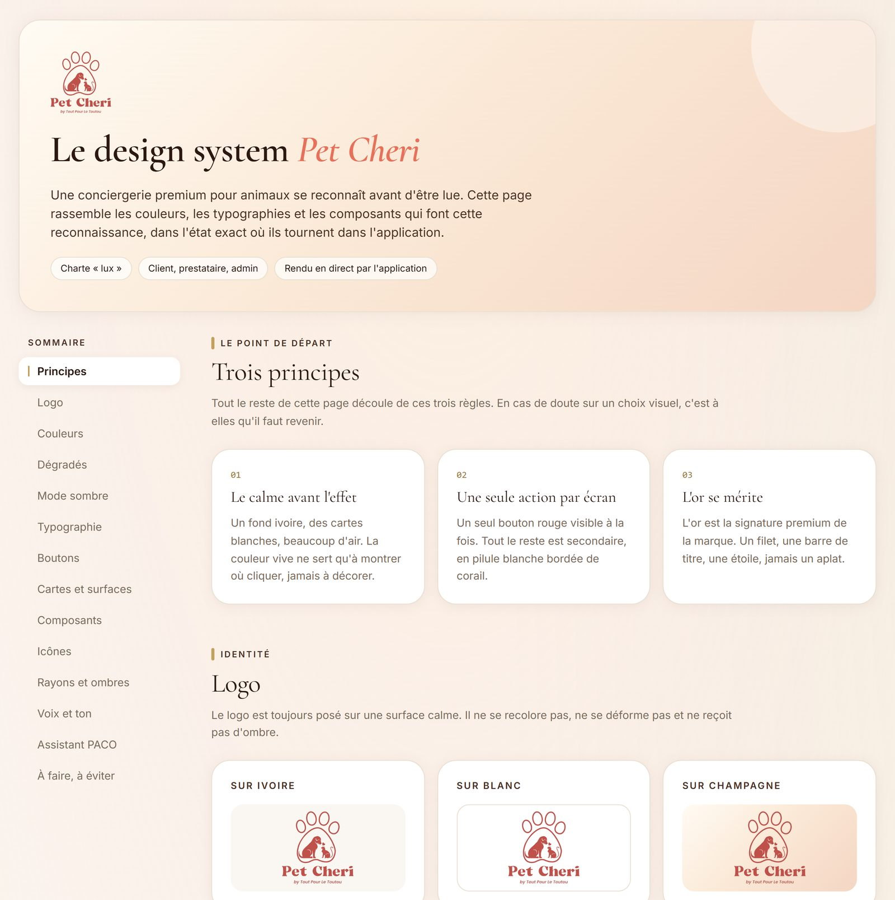
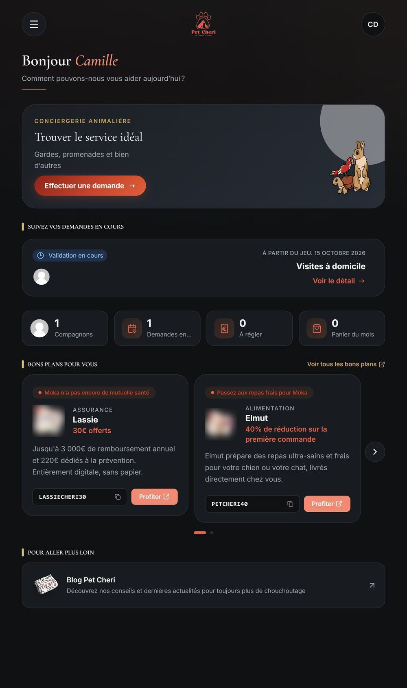
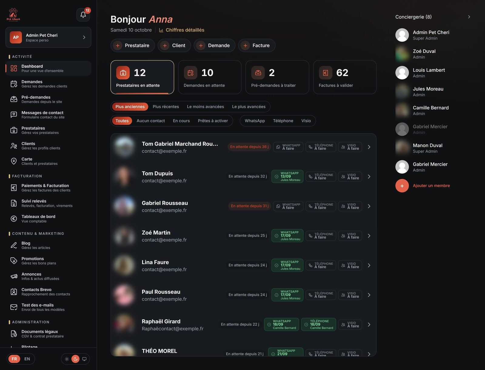

# Le design system « lux »

  
   
  <em>La page <code>/design</code> : la charte rendue par les vrais composants de l'application</em>

## D'où il vient

La charte est née dans l'espace client, au moment de refaire son tunnel d'inscription et son accueil. La référence visuelle était le nouveau site vitrine : il fallait qu'un client qui clique sur « Réserver » ne change pas d'univers. Une fois validée côté client, elle a été étendue à l'espace prestataire, puis à l'espace équipe. Les trois portails partagent aujourd'hui les mêmes tokens et les mêmes composants.

## Trois principes

1. **Le calme avant l'effet.** Un fond ivoire, des cartes blanches, beaucoup d'air. La couleur vive sert à montrer où cliquer, jamais à décorer.
2. **Une seule action par écran.** Un seul bouton principal (pilule dégradé rouge) visible à la fois. Le reste est secondaire : pilule blanche bordée de corail.
3. **L'or se mérite.** L'or est la signature premium : un filet, une barre de titre, une étoile. Jamais un aplat.

## Les tokens

| Rôle | Valeurs |
|---|---|
| Fonds | Ivoire, crème, pêche (badges d'icône) |
| Texte | Chocolat pour les titres, brun grisé pour le secondaire |
| Accents | Or (filets, barres de section), corail et rouge (actions) |
| Dégradés | Rouge pour les boutons principaux, champagne pour les surfaces héro, pêche pour les pastilles d'icône |
| Typographie | Cormorant Garamond pour les titres, Inter pour le texte |

Aucune couleur n'est écrite en dur dans les écrans : tout passe par ces tokens. C'est ce qui a rendu le mode sombre possible.

## Le mode sombre

<table>
<tr>
<td width="50%"></td>
<td width="50%"></td>
</tr>
</table>

- **Les noms des tokens ne changent pas, seules leurs valeurs changent.** Un écran sans couleur en dur bascule sans une ligne de code en plus.
- **Un fond graphite, pas brun.** Une grande surface brune tire vers le terreux ; l'or et le corail ressortent mieux sur un gris très sombre. La chaleur reste dans les petites surfaces (pastilles d'icône).
- **Le thème du téléphone par défaut**, sur les trois portails. Un réglage clair / sombre / système est en bas du menu, à côté de la langue.
- **Pas de flash blanc** : le thème est posé au rendu serveur, et complété avant le premier affichage en mode « système ».
- **Les documents restent clairs.** Une note de débit ou une fiche prestataire générée en PDF depuis un écran sombre partirait fond noir chez le client : tout document destiné au papier est forcé en clair.
- **Une couche de compatibilité** rebranche sur des tokens les centaines d'utilitaires de couleur hérités dans les anciens écrans, avec une valeur claire identique à l'originale : le rendu en clair n'a pas bougé d'un pixel.

## Les icônes

38 icônes animées, dessinées à partir des tracés Lucide et animées au survol. Deux règles :

- **Une icône, un usage.** Deux entrées de menu voisines avec le même pictogramme deviennent indiscernables à 17 pixels : plutôt que recycler l'icône la plus proche, on en dessine une.
- **La patte Pet Cheri, quand elle tient.** Une série d'icônes incruste une petite patte (prestataires, annonces, relevé, promotions, traitements automatiques). Posée sur une barre de graphique, elle se lit comme une sucette : on s'en passe.

Les icônes restent monochromes : leur pastille passe du pêche au rouge au survol, et une couleur figée dans le dessin survivrait mal à ce changement comme au mode sombre.

## Les règles de texte

- Pas d'emoji comme icône.
- Pas de tiret cadratin dans les textes affichés.
- Pas de texte écrit en dur : tout passe par les fichiers de traduction, en français et en anglais.
- Un document destiné au client (note, relance, fiche prestataire) suit **sa** langue, pas celle de l'admin qui le génère.

## La page `/design`

Une page publique (non indexée) qui montre la charte à quelqu'un qui n'a pas accès au code : le marketing, un graphiste, une agence. Elle est rendue par les vrais composants et lit les vraies valeurs des tokens : elle ne peut pas mentir sur l'état de la charte. Ajouter un composant de charte, c'est ajouter sa vignette.
