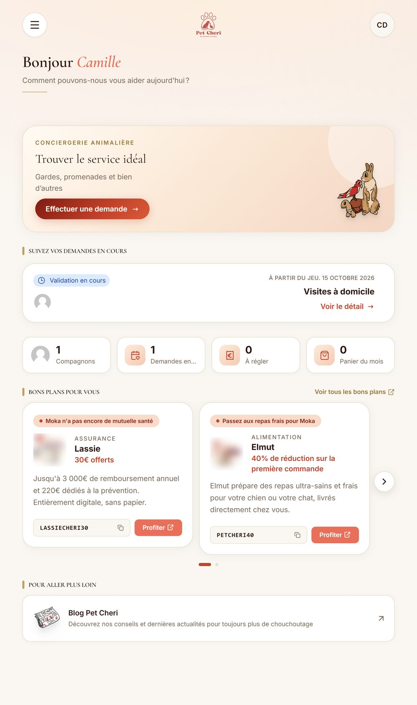
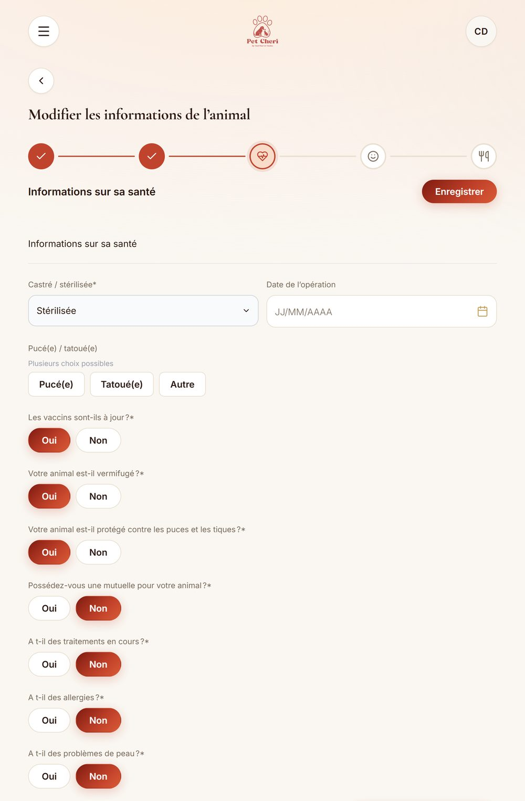
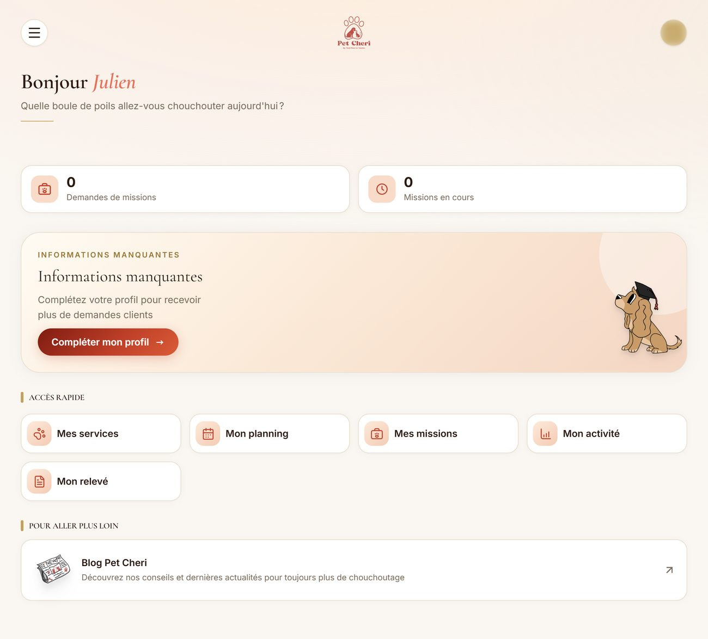
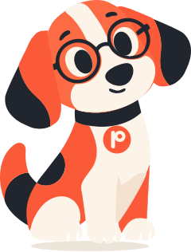

# Parcours client et prestataire

## Le client

### De la vitrine à la demande

Le parcours commence sur petcheri.com. Le héro de l'accueil porte un sélecteur de devis : besoin, animal, adresse, date. Il ouvre le formulaire `/demande` de l'application, **déjà rempli**. Le visiteur n'a pas besoin de compte : sa pré-demande arrive chez l'équipe, qui la convertit en vraie demande en un clic une fois le client rappelé.

Chaque pré-demande garde la page et le bouton de la vitrine qui l'ont amenée : le marketing sait quelles pages font venir des demandes, pas seulement des visites.

Le visiteur qui a un compte Google peut se connecter en un clic depuis la vitrine. Les informations manquantes lui sont demandées avant la création du compte, pas après.

### L'espace client

<table>
<tr>
<td width="50%"></td>
<td width="50%"></td>
</tr>
</table>

- **L'accueil répond aux questions du moment** : la demande en cours et son statut, ce qui reste à régler, le panier du mois, les bons plans qui concernent ses animaux.
- **La fiche animal se remplit en cinq étapes** (photos, identité, santé, caractère, alimentation), avec des choix d'un toucher au lieu de listes déroulantes. Elle nourrit la recherche de prestataire : un chien non castré ou un animal sous traitement écarte les prestataires qui ne l'acceptent pas.
- **Les bons plans sont choisis pour l'animal** : une assurance quand il n'a pas de mutuelle, une offre senior au-delà d'un certain âge. Les mêmes règles s'appliquent sur l'écran de confirmation d'une demande.
- **Les documents suivent la langue du client** : une fiche prestataire, une note ou une relance part en anglais pour un client anglophone, même générée par un admin francophone. Les textes libres des prestataires sont traduits à la volée.
- **Les CGV versionnées** : quand une nouvelle version paraît, le client la relit et l'accepte avant de continuer.

## Le prestataire

### Candidature et recrutement

Un candidat remplit une candidature en ligne. L'équipe suit son parcours en trois étapes (WhatsApp, téléphone, visio), chacune datée et signée par le membre qui l'a menée. Un prestataire activé signe son contrat de prestation dans l'outil, téléverse ses documents, puis attend la validation de l'équipe.

### Au quotidien

  
   
  <em>L'accueil prestataire : missions, informations manquantes, accès rapides</em>

- **Ses services, ses tarifs, ses zones, ses disponibilités** : ce qui alimente la recherche de l'équipe. Un profil incomplet est signalé dès l'accueil, avec ce qu'il lui manque pour recevoir plus de demandes.
- **Le relevé du mois**, par un lien personnel, sans connexion : il coche ce qu'il a fait, ajoute ce qui manque, transmet. PACO peut remplir le relevé à partir d'une phrase (en recette) ; le prestataire relit et envoie.
- **Une double authentification facultative**, et une alerte d'expiration de titre de séjour ou de visa pour ceux qui en ont un.

## L'application mobile

  
   
  <em>Paco, la mascotte qui donne sa voix à l'assistant mobile</em>

L'application mobile (Expo, iOS et Android) couvre les espaces client et prestataire. Elle n'a **pas de backend propre** : elle réutilise l'API de l'application web telle quelle. D'où une règle : tout changement de formulaire côté web est reporté dans un **contrat de parité** qui liste chaque champ (type, bornes, conditions d'affichage, valeur par défaut), puis dans l'application mobile.

Son assistant est **vocal** : le client décrit sa demande à voix haute, Paco la récapitule dans une carte à valider. L'incarnation a changé deux fois :

1. Un **avatar 3D** avec synchronisation labiale : impressionnant, lourd, et pas vraiment « nous ».
2. Un **orbe** animé par la voix : léger, mais anonyme.
3. La **mascotte** : notre chien, dessiné en calques (respiration, tête qui penche, mâchoire qui suit le volume de la voix, queue). Elle dit la même chose que l'orbe, et c'est la marque.

L'application est en cours de finalisation avant sa publication sur l'App Store et Google Play.
