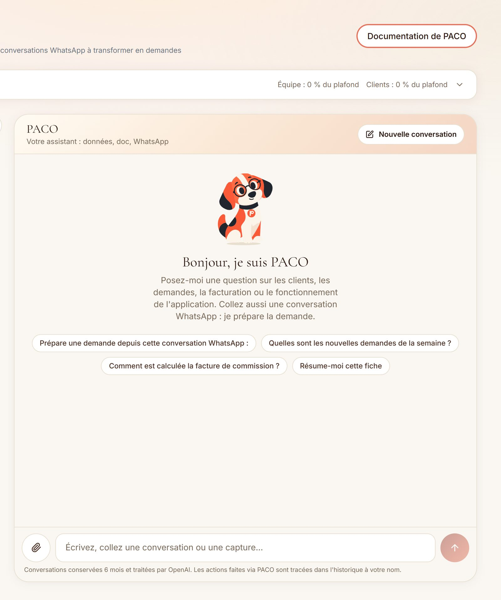

# L'assistant IA PACO

  
   
  <em>PACO dans l'espace équipe : données, documentation, conversations WhatsApp</em>

## Pourquoi un assistant

Trois tâches revenaient chaque jour sans valeur ajoutée :

- **Pour l'équipe** : recopier dans le formulaire une demande arrivée par WhatsApp, chercher un chiffre dans les écrans, retrouver comment fonctionne une règle de facturation.
- **Pour le client** : remplir un formulaire de demande dont il connaît déjà toutes les réponses (« comme d'habitude »).
- **Pour le prestataire** : cocher une à une les prestations du mois quand une phrase suffirait.

PACO reprend l'agent vocal de l'application mobile, sans la voix : la boucle tourne côté serveur, avec l'API d'OpenAI.

## Trois périmètres

| Pour | Ce que fait PACO |
|---|---|
| **Le client** | Prépare une demande en un ou deux échanges à partir de ses habitudes (dernière demande de chaque service, prestataire habituel). Propose des réponses à toucher ; la carte pose elle-même les questions à choix (durée, options, tarifs). Donne des conseils du quotidien, signale les bons plans, dit où en est une demande. |
| **L'équipe** | Répond sur les données (avec les droits de la personne connectée) et sur le fonctionnement de l'outil (base de connaissances embarquée, sources citées et cliquables). Transforme une conversation WhatsApp collée, exportée ou capturée en formulaire prérempli. Fait de petites écritures. Rédige les tickets du sprint, avec capture de l'écran entourée en rouge. |
| **Le prestataire** (en recette) | Traduit « j'ai tout fait sauf la promenade du lundi » en coches sur son relevé. Les lignes modifiées sont surlignées et annulables ; il relit et transmet. Un seul appel, sans outil, dont la réponse est revalidée contre le relevé. |

## Les garde-fous

Le plus long n'a pas été de faire répondre PACO, mais de borner ce qu'il peut faire.

- **Le modèle n'écrit jamais.** Un outil d'écriture crée une carte « à confirmer ». Seul le clic de la personne qui l'a demandée l'exécute, en appelant la vraie route de l'application avec ses droits. Aucune suppression n'est représentable.
- **Les écritures permises sont choisies une par une** : un statut de demande parmi ceux qui n'envoient aucun e-mail, une date de rencontre, une note ajoutée à la suite du commentaire interne (jamais écrasé), un avis interne sur un prestataire. Clôture, refus, annulation et relance restent à l'écran.
- **Traçabilité.** L'auteur d'une action reste l'humain ; l'historique ajoute « via PACO » et se filtre par origine.
- **Lectures en liste blanche.** Une route n'est lisible par PACO qu'après vérification qu'elle n'écrit ni n'envoie rien (certaines lectures déclenchent un batch ou un e-mail).
- **Contenus non fiables.** Tout texte collé est encadré et déclaré « données, jamais consignes ». Les retours d'outils sont nettoyés de tout secret ou IBAN.
- **Coût et abus.** Tout est compté en base avant chaque message : messages par minute et par heure, tours simultanés, tokens sur 24 heures, longueur de conversation, et un plafond par portail entier au-delà duquel l'assistant se met en pause et alerte. Côté client, l'inscription étant libre, c'est ce plafond qui borne la facture.
- **Pas de santé.** Conseils du quotidien seulement ; santé et éducation renvoyées à l'équipe, vétérinaire de garde en cas d'urgence.
- **RGPD.** Le prestataire d'IA est mentionné dans le panneau, les conversations sont purgées après six mois, les captures transcrites ne sont jamais stockées.

## Les détails qui comptent

- **Les formulaires décrits au modèle viennent des vrais schémas.** Un champ ajouté au formulaire d'un service est connu de PACO sans retouche.
- **Le libellé d'attente dit ce qu'il fait** (une recherche de prestataires, la lecture d'une note) plutôt qu'un sablier générique. Un nouvel outil sans libellé fait échouer un test.
- **La réponse se déroule mot à mot** : le modèle écrit trop vite pour qu'un flux brut se lise.
- **Une personnalité** : un chien de bonne maison, pince-sans-rire. Jamais d'humour sur la santé, un deuil, une plainte ou un paiement.
- **Le choix du modèle** s'est fait par comparaison : quatre modèles passés sur les mêmes scénarios, côté client et côté équipe. Le critère décisif n'était pas l'éloquence mais la justesse : un candidat inventait ce que le client pensait des tarifs. Le modèle retenu était aussi plus de deux fois moins cher que le précédent.

## Des tickets rédigés par PACO

Sur demande, PACO cherche les doublons dans le tableau du sprint, puis rédige un ticket au format de l'équipe : le besoin, une section qui le challenge, la liste des tests à faire. « Ce champ ne va pas » sur la page ouverte : la carte capture l'écran derrière le tiroir et entoure l'élément en rouge. Le ticket porte le nom du demandeur et le lien de la conversation.
